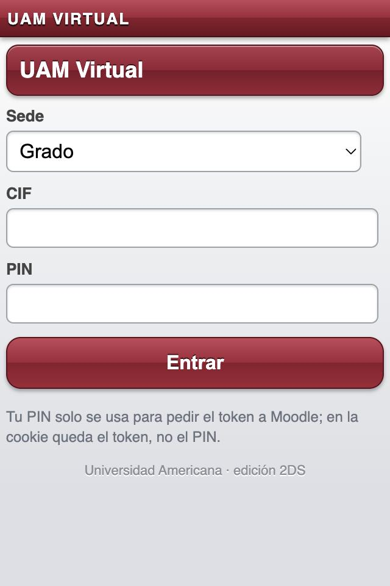
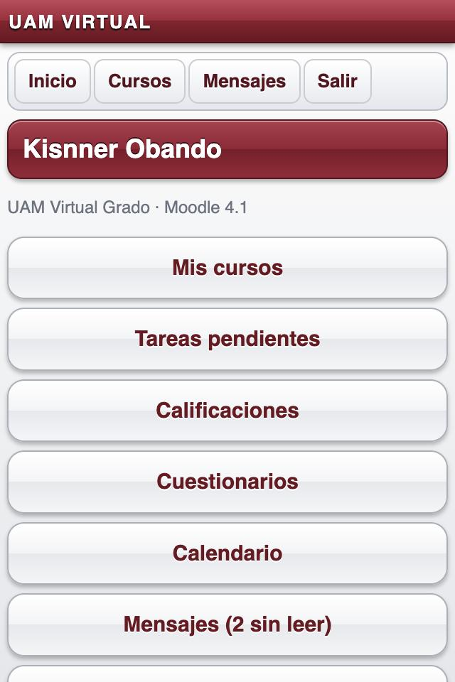
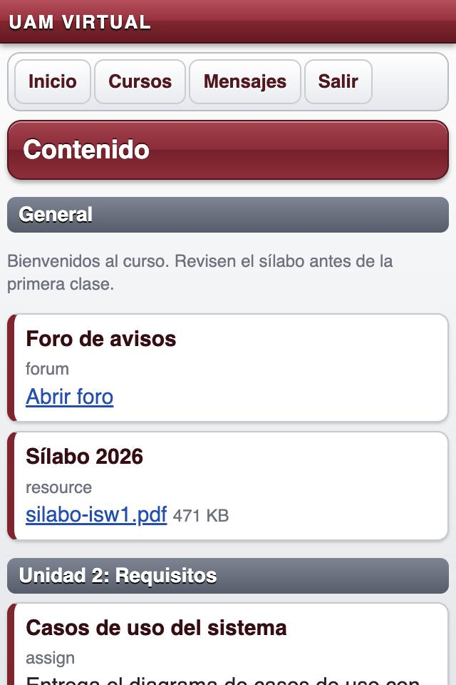
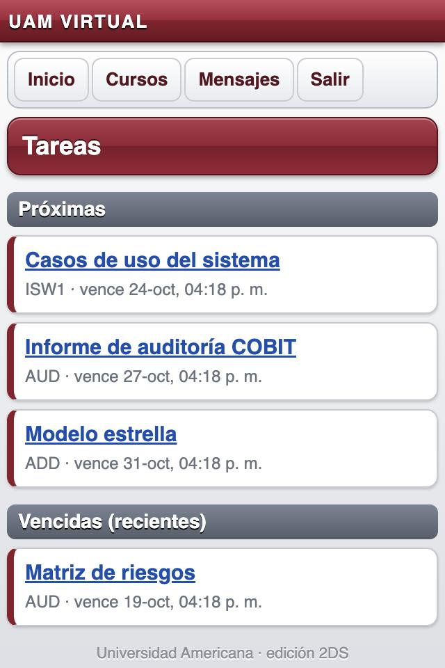
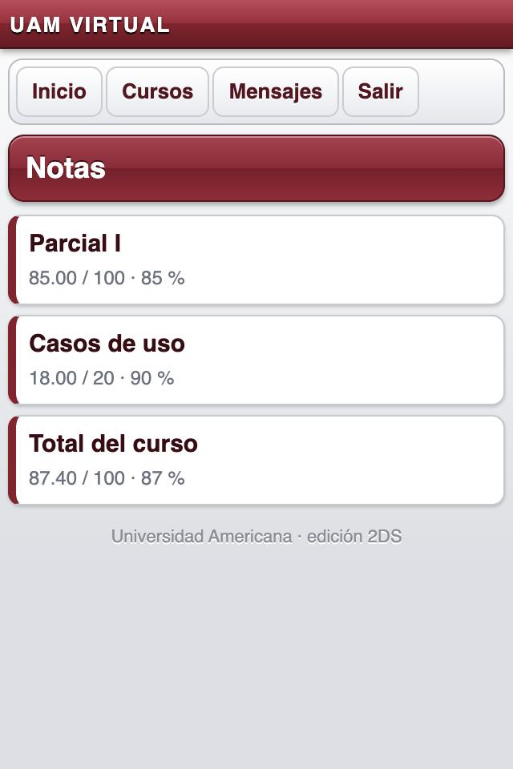
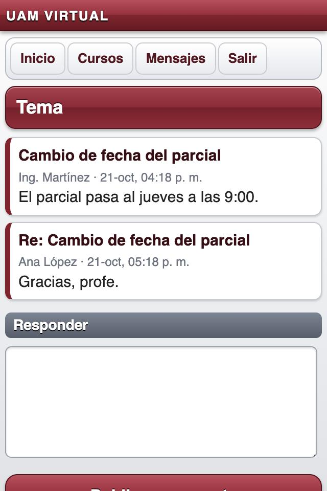
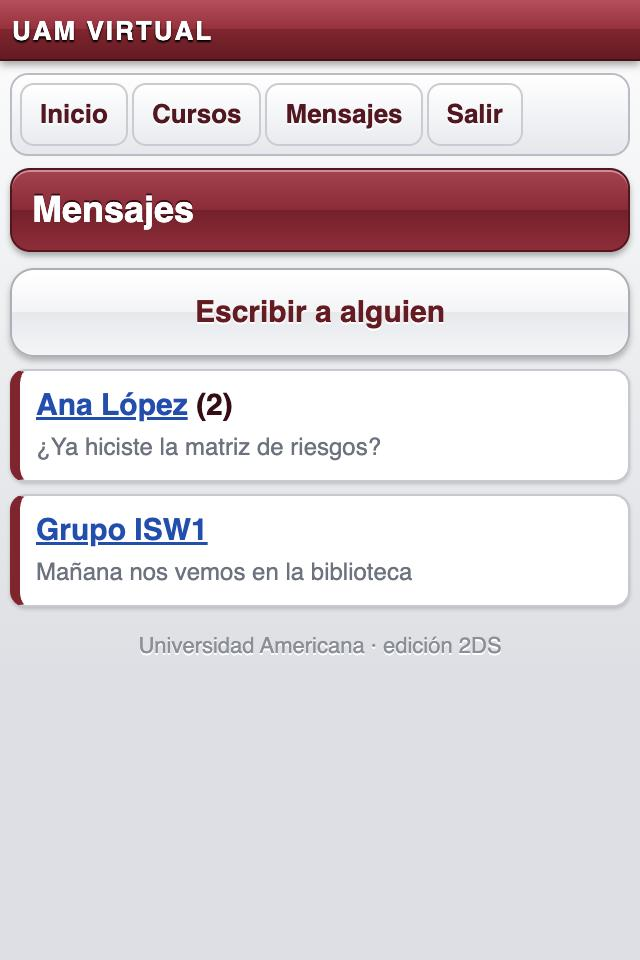
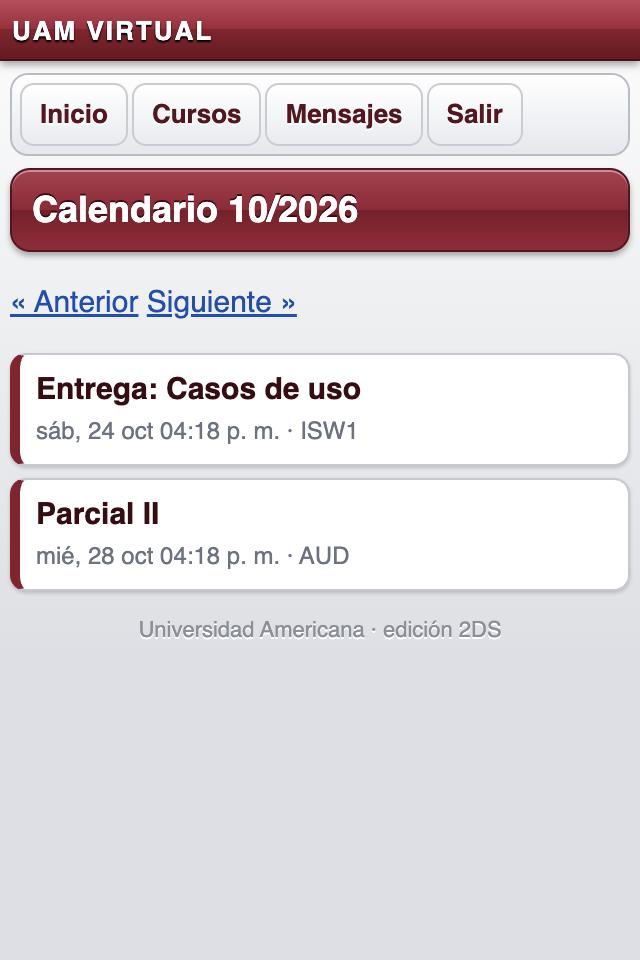

# Musgo — UAM Virtual para Nintendo 2DS / 3DS

Cliente web mínimo de UAM Virtual (Moodle) pensado para el navegador de la 2DS:
HTML plano renderizado en el servidor, sin JavaScript, sin CORS, con botones grandes.
Usa el mismo web service (`moodle_mobile_app`) que la app de Mac.

Funciones: cursos y contenido (archivos y enlaces), tareas (ver estado, entregar texto),
calificaciones, cuestionarios (solo ver intentos), foros (leer y responder), mensajes
(leer y enviar), notificaciones, calendario, participantes, perfiles y búsqueda de cursos.

## Capturas

Con datos de ejemplo (`tools/mock-moodle.js`), a 320 px de ancho como la pantalla de la consola.

| | | | |
|:-:|:-:|:-:|:-:|
| <br>Login | <br>Inicio | <br>Contenido | <br>Tareas |
| <br>Notas | <br>Foro | <br>Mensajes | <br>Calendario |

Para regenerarlas: `node tools/mock-moodle.js` y `MOODLE_URL=http://localhost:8090/ node server.js`, con cualquier CIF/PIN.

## Probar local

```bash
node server.js   # http://localhost:8080
```

## Desplegar

Necesita un servidor Node (no es una página estática: Moodle no permite CORS y el
navegador de la consola no soporta JS moderno). En Vercel: importar el repo tal cual.

Aviso: el navegador de la 2DS original solo habla TLS antiguo; si el host exige TLS 1.2+
la consola mostrará error de certificado. Hay que servirlo en `http://` o detrás de un
proxy que acepte TLS viejo.
